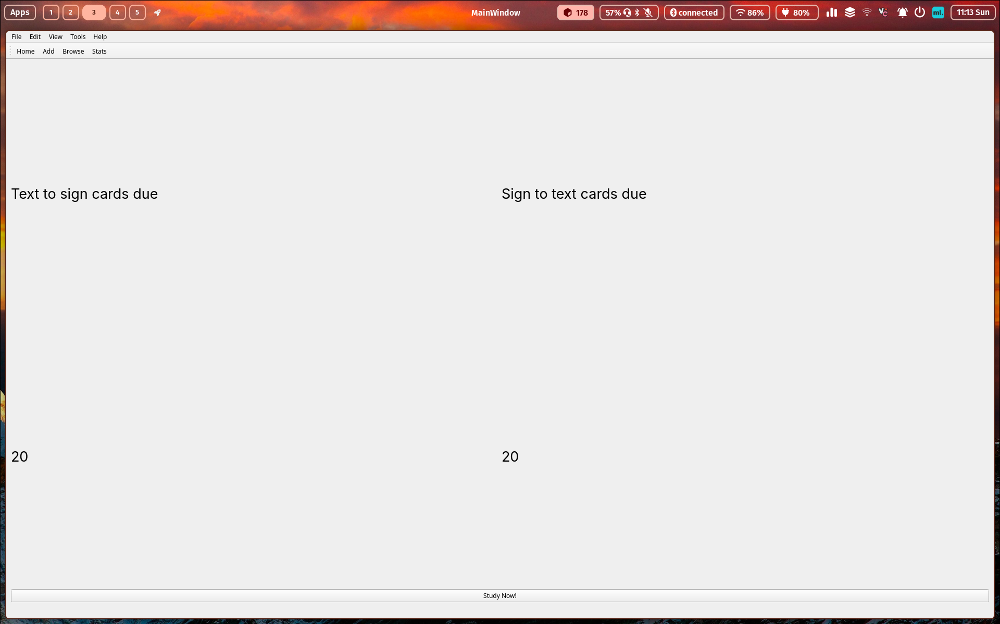
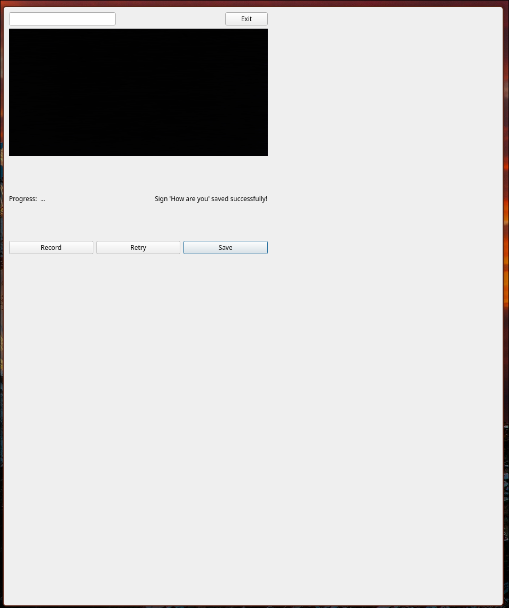

# inDEX - spaced repetition for sign languages

## Inspiration

Learning vocab for a foreign language in 2026 is easy. You add flashcards to Anki, review the cards, and repeat. Doing the same for a sign language is more complicated. You have to attend classes or follow a course and hope you memorise the signs eventually. Right now there is no way to continually practise signs you struggle to remember without manually tracking words and answer videos on a computer.

## What It Does

Anki for British Sign Language. The app asks you to sign a phrase. You sign the phrase, and via the web cam recording, the app tells you whether your sign matched the correct sign or not. If you fail, the flashcard will be shown again until you pass.

## How We Built It
- Frontend: PYQt6 - "home page and review screen"
- Backend: Python, Google MediaPipe, OpenCV, FastDTW - "handles processing the video and comparing it to the answer video"
- Database: SQLlite - "stores flashcards - answer videos and phrases / words"
- Design: Microsoft Word, Qt Designer - "plan and design project"

## Challenges We Ran Into
- A lot of code online is written for PyQt5 but we are using PyQt6. We had issues with getting the QCamera widget to work
- Livestreaming the video to the backend meant that instead of processing an array of frames we had to process them one by one which was a lot more difficult
- Since none of us had worked on the stack before, we weren't actually sure how PyQt6 would send signals or data to the backend

## Accomplishments That We're Proud Of
- First time using the opencv library
- First time using PyQt6 for frontend development
- First overnight hackathon

## What We Learned
- Sleep is important
- Should communicate our ideas more at the start so we don't have to do any U turns later

## What's Next
- Add fingerspelling practise
- The ability to create sign language sentence videos from premade videos of signed words stored in the database
- Use the Free Spaced Repetition Scheduler (FSRS) which is better

